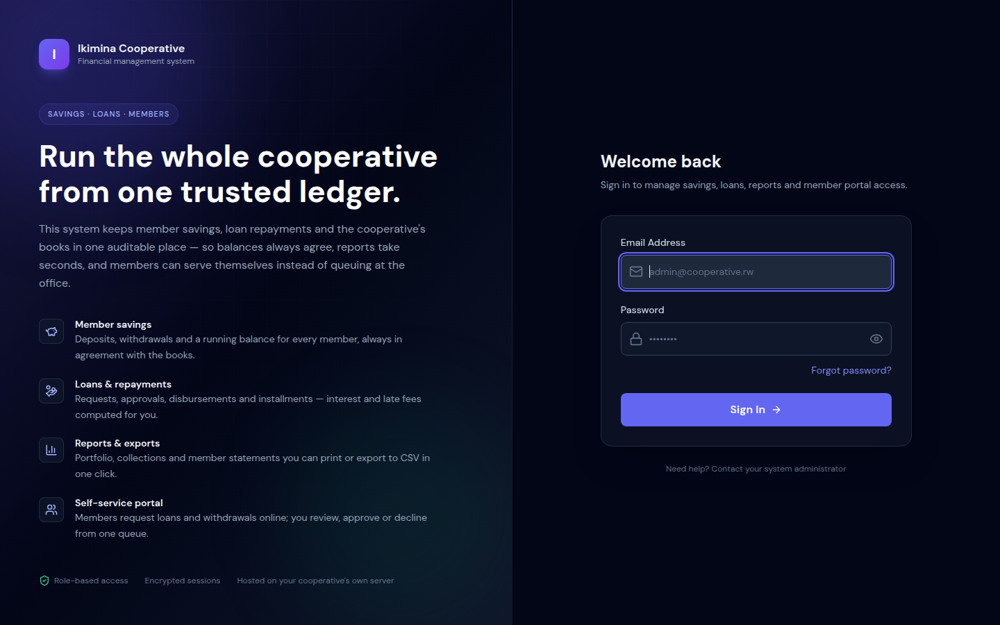
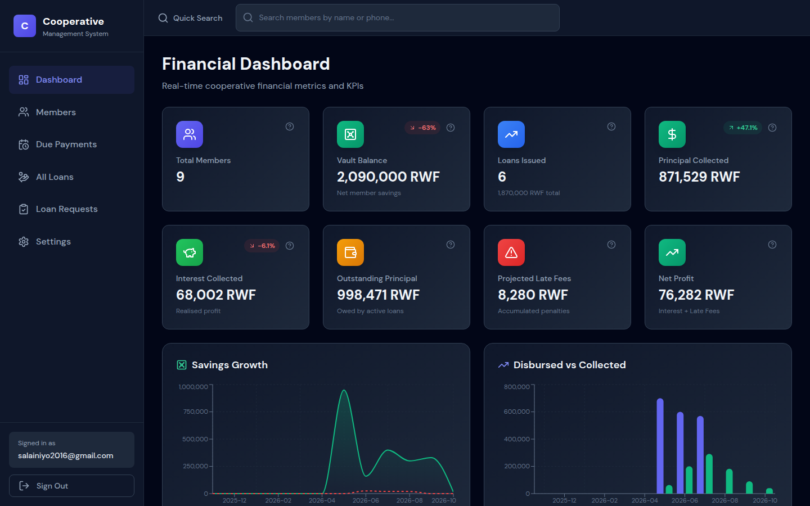
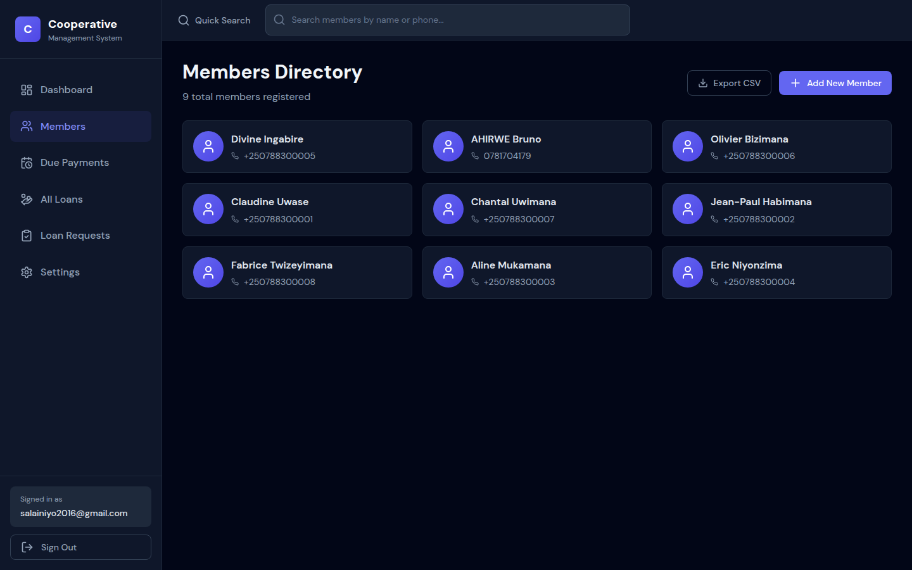
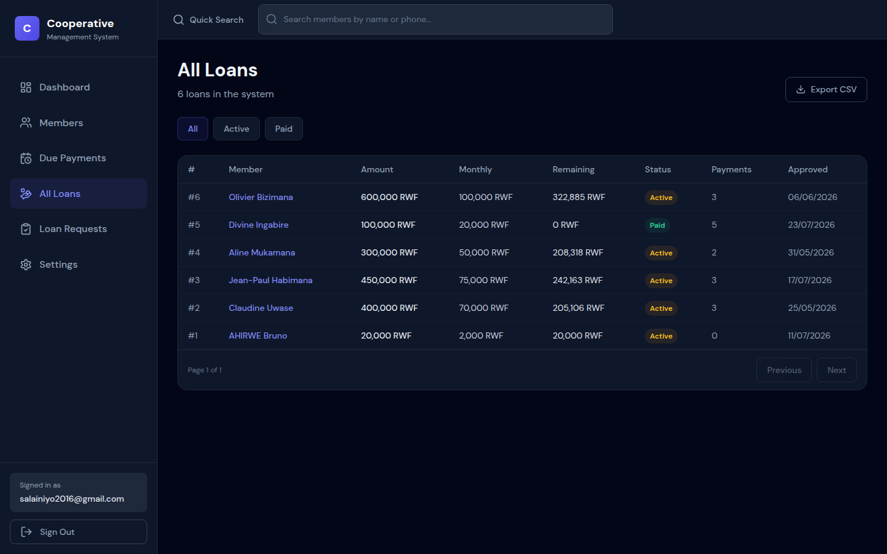
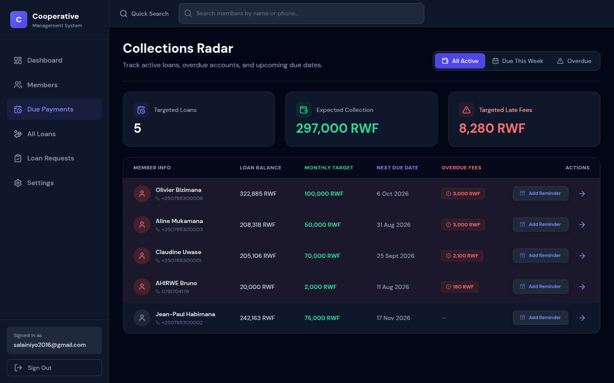

# Ikimina — Cooperative Financial Management System

[](https://github.com/salainiyo/cooperative-system-management/actions/workflows/backend-ci.yml)
[](#testing)
[](https://ikimina.duckdns.org)
[](LICENSE)

A full-stack financial management platform for a local savings cooperative (Ikimina):
member savings, loans with declining-balance interest and late fees, repayments,
a member self-service portal, password recovery over email, and portfolio
reporting with CSV exports.

Built around **mathematical accuracy and data integrity**: every payment is
distributed with a waterfall rule (late fees → interest → principal), balances
are recalculated from the transaction ledger, and every financial rule is
configurable from the admin UI — never hardcoded.

**🌍 Live demo: [ikimina.duckdns.org](https://ikimina.duckdns.org)** — running on a
$0/month Oracle Cloud free-tier VM, provisioned entirely with Terraform + Ansible.
The demo runs seeded sample data; sign-in credentials available on request.



## Contents

- [Why it's interesting](#why-its-interesting)
- [Live demo](#live-demo)
- [Features](#features)
- [Architecture](#architecture)
- [Financial logic](#financial-logic)
- [Engineering highlights](#engineering-highlights)
- [Key technical decisions](#key-technical-decisions)
- [Getting started](#getting-started)
- [Testing](#testing)
- [CI/CD](#cicd-github-actions--docker-hub)
- [Cloud deployment (Terraform + Ansible)](#cloud-deployment-terraform--ansible)
- [Project structure](#project-structure)
- [Security](#security)
- [Roadmap](#roadmap)
- [Author](#author)

## Why it's interesting

| | |
|---|---|
| **Production-deployed** | Real HTTPS domain, provisioned by IaC — not just `localhost` |
| **Money is treated seriously** | Server-side waterfall allocation, ledger-derived balances, configurable rates |
| **85 automated tests** | 55 pytest (SQLite **and** PostgreSQL) + 30 Vitest/RTL, all in CI |
| **Full CI/CD** | Tests gate every push; `main` publishes versioned Docker images |
| **Infrastructure as Code** | Terraform with free-tier guardrails + idempotent Ansible playbook |
| **~11,000 lines** | 95 Python/JavaScript source files, MIT-licensed |

## Live demo

**https://ikimina.duckdns.org** — admin console and member portal, seeded with
sample cooperative data (8 members, savings history, active loans, repayments).

> Credentials are available on request — the account with admin rights can see
> everything; portal logins show the member's own data only.



## Features

**Admin console**
* Dashboard with KPI cards (`?` tooltips explaining every metric), 30-day trend
  badges, savings-growth and disbursed-vs-collected charts, capital-health and
  loan-performance panels.
* Members directory, member profiles, deposits/withdrawals, loan issuance,
  payments with waterfall allocation, printable member statements.
* **Due Payments (Collections Radar)** — one backend query powers the whole
  table (no N+1), filters for due-this-week / overdue, calendar reminders.
* **All Loans** — paginated, filterable list with CSV export.
* Loan requests queue (approve/reject with notes → creates the loan, emails the member).
* Reports: portfolio aging + Portfolio-at-Risk, collections, and savings/loans/
  payments CSV exports.
* Settings: organisation name, interest rate (default 1.5% flat, declining
  balance), late-fee rate (default 3%/month), loan↔savings multiplier (default
  2×), and **Gmail SMTP (app password)** stored Fernet-encrypted, never returned
  by the API.
* Portal account management for members: create/reset/revoke/delete logins.

**Member portal** (`/account`, `/loans`, `/request-loan`, …)
* Members sign in with credentials issued by the office and view their own
  savings, loans, and payment history — nothing else (403s for admins and
  unlinked users).
* Loan eligibility with the maximum they can request (`savings × multiplier`)
  and a guided loan-request form with status tracking.
* Change their own password.

**Auth & recovery**
* `POST /auth/setup` bootstraps the first admin (only while the user table is empty).
* Admin-only registration of additional staff accounts.
* Forgot/reset password via emailed, single-use, 30-minute tokens (generic
  responses — no user enumeration). Password changes invalidate every previously
  issued JWT (`iat` check).
* Rate limits on login/refresh/forgot-password, refresh-token rotation with
  reuse detection, blocklisted tokens on logout.

### Screenshots







## Architecture

```
Browser ──HTTPS──▶ Caddy ──/api/* (prefix stripped)──▶ backend (FastAPI, port 80)
                       └──everything else───────────▶ frontend (Nginx, React SPA)
```

| Service | Image | Role |
|---|---|---|
| `caddy` | caddy:2 | TLS certificates, `/api` reverse proxy, static SPA |
| `backend` | `alains04/coop-backend` | FastAPI + SQLModel; runs `alembic upgrade head` on start |
| `frontend` | `alains04/coop-frontend` | React 18 SPA served by Nginx |
| `postgres` | postgres:16-alpine | Production database (healthchecked) |
| `redis` | redis:7-alpine | Rate-limit state |

Local development uses SQLite (`DATABASE_URL=sqlite:///./dev.db`) — zero setup,
same migrations, both engines exercised in CI.

## Financial logic

The domain rules live in the backend and are configurable at runtime
(*Settings*), not hardcoded:

* **Interest** — flat rate on the **remaining** balance (declining balance),
  default `1.5%` per period.
* **Late fees** — `3%/month` accrued against missed installments, computed from
  the loan's actual due dates.
* **Waterfall allocation** — each payment is split server-side:
  *late fees → interest → principal*. Clients only send the cash amount.
* **Balances are derived**, never stored-and-trusted: savings balance and loan
  remaining balance are recalculated from the ledger, so the books always agree.
* **Guardrails** — money fields validated `> 0`, withdrawals capped at the
  member's balance, loans immutable once payments exist, member deletion blocked
  while savings or an active loan remain.

## Engineering highlights

### Testing — 85 tests, two databases

```bash
# backend: 55 tests (auth, password reset, settings/SMTP, portal, loan
#          requests, savings/withdrawals, reports & CSV exports)
cd backend && pytest -q                       # SQLite
TEST_DATABASE_URL=postgresql+psycopg2://… pytest -q   # PostgreSQL (CI runs both)

# frontend: 30 tests (formatters, tooltip a11y, confirm dialog, login,
#           network-error handling, savings modal, member directory)
cd frontend && npm test && npm run build
```

The migration chain is additionally verified from an **empty** database on
every push (`alembic upgrade head` in CI), so schema changes are proven to
apply cleanly — on both engines.

### CI/CD — every push, gated

`.github/workflows/backend-ci.yml` runs three jobs: `test-backend` (SQLite →
PostgreSQL → migrations), `test-frontend` (vitest + production build), and —
only when both pass on `main` — `build-and-push`, which publishes
`alains04/coop-backend` and `alains04/coop-frontend` to Docker Hub tagged
`latest`, `sha-<7>`, `main`, and any git tag. **Deploy = pull**, so the
1 GB server never builds anything.

### Security

**Application** — JWTs carry `iat` + `jti`; refresh tokens are single-use
(rotated, reuse is rejected); password changes invalidate all outstanding
sessions; admin/portal routes are separated by RBAC (403s both ways); reset
flows don't reveal whether an account exists; the SMTP password is
Fernet-encrypted at rest and masked in every API response; CORS never uses `*`
with credentials.

**Server** (Ansible) — SSH key-only with a hardened drop-in config, `ufw`
(22/80/443), fail2ban, unattended security upgrades, 2 GB swap, Docker log
rotation, automated encrypted backups with 7-day retention.

### Performance & UX

* Route-level code splitting (`React.lazy`) — the dashboard, reports and portal
  load as separate bundles.
* The Due Payments radar resolves with **one** backend query instead of N+1.
* SlowAPI rate limiting backed by Redis on auth endpoints.
* User-facing failures are translated (e.g. offline → *"Connection error —
  check your internet connection and try again."*, never raw `Failed to fetch`).
* Optimistic loading states, accessible tooltips (`role="alert"` errors,
  keyboard-focus management), responsive down to mobile.

## Key technical decisions

| Decision | Why |
|---|---|
| **Caddy** instead of nginx + certbot | Automatic HTTPS and certificate renewal in one binary — fewer moving parts on a small VM |
| **Single VM + Docker Compose** instead of Kubernetes | The scale is a cooperative office, not hyperscale; Compose is auditable on 1 GB RAM and the stack stays portable |
| **PostgreSQL in production, SQLite in dev** | Zero-friction development; the same Alembic migrations run on both (and CI proves it) |
| **Financial rules in the DB settings table** | Cooperatives negotiate rates; changing policy must not require a redeploy |
| **Server-side payment allocation** | Clients can't disagree with the books — the API is the single source of truth |
| **Terraform variable validations for free tier** | A non-free shape or oversized disk fails at `plan` — you cannot accidentally receive a bill |
| **Images built in CI, pulled on deploy** | Keeps the 1 GB instance free for the app, and rollbacks are a tag change |

## Getting started

Prerequisites: Docker + Docker Compose.

```bash
# 1. Configure the environment (root of the repo)
cp .env.example .env     # edit SECRET_KEY, POSTGRES_PASSWORD, ALLOWED_ORIGINS, FRONTEND_URL

# 2. Build and start everything (migrations run automatically on backend start)
docker compose up -d --build

# 3. Create the first admin account — only possible while no users exist
curl -X POST http://localhost/api/auth/setup \
  -H 'Content-Type: application/json' \
  -d '{"email":"admin@yourcoop.rw","password":"choose-a-strong-password"}'
```

Open `http://localhost` and sign in. Then:

1. *Settings → Email*: enter the Gmail address + 16-character **app password**
   (myaccount.google.com → Security → App passwords), send a test email.
   Until then, password-reset emails return 503.
2. *Members → Add New Member*, record savings, then *Portal Access* on the
   member profile to create their portal login (temp password is emailed and
   shown once).

Detailed environment variables are documented in [`.env.example`](.env.example)
and the table below:

| Variable | Default | Purpose |
|---|---|---|
| `SECRET_KEY` | — (required) | Signs JWTs and encrypts the stored SMTP password |
| `DATABASE_URL` | `sqlite:///./dev.db` | Compose injects the PostgreSQL URL automatically |
| `POSTGRES_PASSWORD` | `coop_secret` | PostgreSQL password (keep it in `.env`) |
| `ALLOWED_ORIGINS` | localhost dev origins | Comma-separated CORS origins — never `*` with credentials |
| `FRONTEND_URL` | `http://localhost:5173` | Base URL used in password-reset emails |
| `REDIS_URL` | `memory://` | Rate-limit backend (Compose uses the `redis` service) |

The Gmail app password is **not** an environment variable — it is entered in
the admin Settings UI and stored encrypted in the database.

## Testing

| Suite | Count | Covers |
|---|---|---|
| `backend/tests` (pytest) | 55 | Auth & RBAC, password reset, SMTP settings, member portal, loan requests, savings/withdrawals, reports & CSV exports, migrations |
| `frontend/src` (Vitest + RTL) | 30 | Formatters, tooltip a11y, confirm dialog, login flow, network-error UX, savings modal, member directory |

Both suites run on every push and PR — see [CI/CD](#cicd-github-actions--docker-hub).

## CI/CD: GitHub Actions → Docker Hub

| Job | When | What it does |
|---|---|---|
| `test-backend` | every push/PR | 55 pytest tests on SQLite, same suite on PostgreSQL, migrations from an empty DB |
| `test-frontend` | every push/PR | 30 vitest tests + production build |
| `build-and-push` | pushes to `main`, after tests | Buildx with layer cache → Docker Hub (`latest`, `sha-<7>`, `main`, git tags) |

```bash
docker compose pull && docker compose up -d          # deploy what's on main
# rollback: pin image: alains04/coop-backend:sha-<known-good> and up -d again
```

Required secrets: `DOCKERHUB_USERNAME`, `DOCKERHUB_TOKEN` (access token).

## Cloud deployment (Terraform + Ansible)

The live site runs on **one Oracle Cloud Always Free AMD micro instance**
(1/8 OCPU, 1 GB RAM — $0/month), provisioned from this repository:

```bash
cd infra/terraform && cp terraform.tfvars.example terraform.tfvars  # + Phase 0: ../README.md
terraform init && terraform plan && terraform apply   # VCN, security list, VM, inventory

cd ../ansible && cp inventory/group_vars/all/vault.yml.example inventory/group_vars/all/vault.yml
ansible-vault encrypt inventory/group_vars/all/vault.yml
ansible-playbook playbooks/site.yml -v               # harden, swap, Docker, deploy, DuckDNS, backups
```

* **Guardrails**: variable validations make it *impossible* to plan a non-free
  shape or a boot volume outside 47–200 GB.
* **Idempotent**: the playbook re-runs clean (32 ok / 0 changed on a second run).
* Full runbook: [`infra/README.md`](infra/README.md).

## Project structure

```
backend/
  api/            routers: services (members/loans/payments/savings/admin),
                  auth, portal, loan requests, member accounts, reports/exports
  core/           crypto (Fernet), email (SMTP), settings cache, rate limiting
  models/         SQLModel tables + DTOs; business logic (waterfall, due dates)
  dependancies/   auth (JWT), admin guard, helpers
  migrations/     Alembic revisions
  tests/          pytest suite (session/client/admin/email fixtures)
  entrypoint.sh   alembic upgrade head → uvicorn
frontend/
  src/components/ admin pages, member-portal pages, modals, ui/ primitives
  src/utils/      format helpers (formatRWF, dates)
  src/content/    KPI explanations shown in dashboard tooltips
  src/context/    toast notifications
infra/
  terraform/      OCI free-tier VM + network (+ free-tier guardrails)
  ansible/        hardening, swap, Docker, stack deploy, DuckDNS, backups
.github/workflows/backend-ci.yml   tests → Docker Hub images
```

## Security

* JWTs carry `iat`; tokens issued before a password change are rejected everywhere.
* Refresh tokens are single-use (rotated, reuse is rejected); all tokens carry a `jti`.
* Member portal and admin routes are strictly separated (403s both directions).
* Money fields validated `> 0`; withdrawals cannot exceed the member's balance;
  loans cannot be edited/deleted after payments exist.
* The SMTP password is encrypted at rest and masked in API responses; reset
  emails never reveal whether an account exists.
* The server itself: key-only SSH, ufw, fail2ban, automatic security patches —
  all enforced by Ansible, not by hand.

## Roadmap

* SMS/WhatsApp reminders for due payments (cooperatives run on mobile money).
* Email audit log & month-end statement emails to members.
* Granular staff roles (teller vs. auditor) beyond the current admin/member split.
* Offline-tolerant PWA for field officers.
* Horizontal scale-out (managed DB + second instance) if membership outgrows
  one VM — the Compose stack moves unchanged.

## Author

**Niyomugabo Alain Salvator** — designed, built and deployed end-to-end:
backend, frontend, tests, CI/CD, and cloud infrastructure.

* GitHub: [@salainiyo](https://github.com/salainiyo)
* Email: salainiyo2016@gmail.com
* Live system: [ikimina.duckdns.org](https://ikimina.duckdns.org)

## License

[MIT](LICENSE) © 2026 Niyomugabo Alain Salvator
